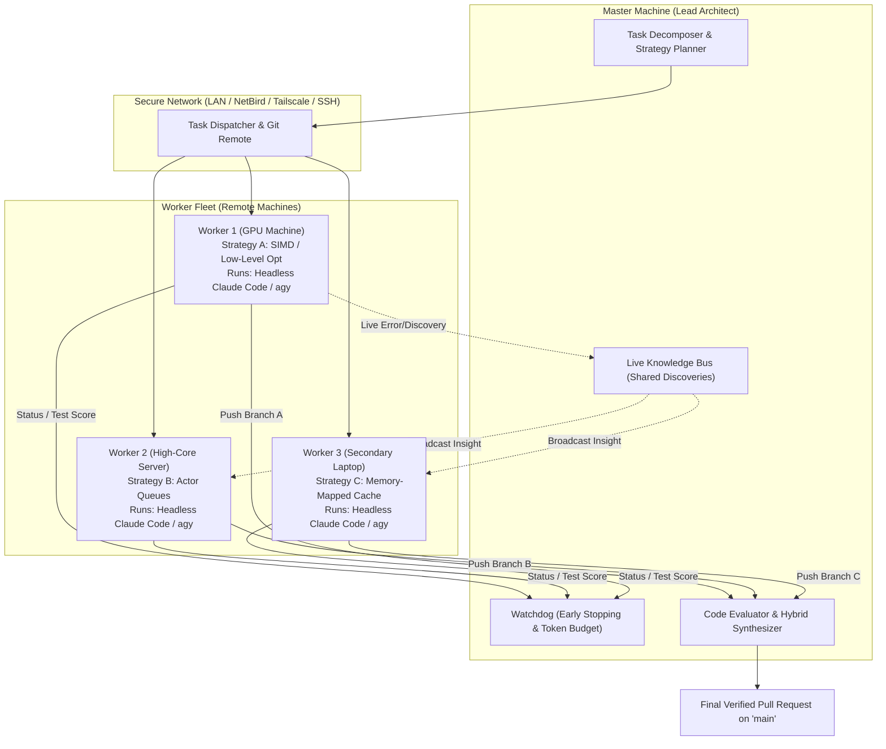

# HiveMind: Distributed AI Coding Agent Fleet
## Architecture, Problem Analysis, Industry Gaps & Technical Blueprint

---

## 1. The Big Picture: What We Are Building (Plain English)

Imagine you are leading a software engineering team with a very tough coding challenge and a tight deadline. 

Instead of having just **one programmer** work on the problem sequentially (which is slow, linear, and easily gets stuck), you have a **team of AI developers** running on multiple computers at the same time:

1. **The Lead Architect (Master Machine):** You explain what needs to be built to the master computer. The Master breaks the task down, formulates different strategies to solve it, and assigns them across the other computers available on your network.
2. **The Worker Developers (Worker Machines):** Each worker computer gets its own isolated copy of the code, opens an AI coding terminal (like Claude Code, Antigravity CLI `agy`, or Aider), writes the code, executes local builds, runs test suites, and checks performance benchmarks on its own hardware.
3. **The Final Assembly:** When the workers finish, they send their results, test scores, and code changes back to the Lead Architect. The Master reviews the solutions, picks the best working code (or combines the best parts from different workers), and merges it into the main project.

In short: **We are turning multiple computers into a coordinated AI development team that explores multiple solutions in parallel, tests them automatically, and delivers the winning code.**

---

## 2. The Problem: Why Single-Agent Development Hits a Wall

Frontier AI coding agents are extraordinarily capable, but when applied to compute-heavy, performance-critical, or time-sensitive projects, the **single-machine, single-agent model breaks down**:

1. **The Sequential Trial-and-Error Bottleneck:** Complex engineering challenges (e.g., optimizing database throughput, deep refactoring, fixing race conditions) rarely have an obvious single solution. A single agent tries Approach A, gets stuck after 20 minutes, rolls back, and tries Approach B. Exploring three distinct approaches sequentially can easily take over an hour.
2. **Idle Computing Power:** Many developers and teams have access to multiple machines—a high-end workstation with a dedicated GPU, a multi-core cloud VPS, and a development laptop. Under existing tools, all but one machine sit completely idle while you wait on a single thread of execution.
3. **No Safety in Long-Horizon Tasks:** If a single agent wanders down a flawed design path or gets caught in a circular compiler error loop, the entire development session is wasted.

---

## 3. Current Solutions in the Market

The current landscape of AI development tools falls into three primary categories:

* **Single-Machine Coding CLIs (Claude Code, Aider, Cursor, Antigravity CLI):** Excellent at interactive coding inside a single project folder, but strictly single-process with no native mechanism to coordinate across multiple physical machines.
* **Enterprise Cloud Agent Platforms (Devin Enterprise, OpenHands Cloud):** Platforms that spin up sandboxed cloud virtual machines for GitHub issues. They are heavy, costly, cloud-locked, and cannot easily leverage your own physical hardware, local GPU clusters, or private on-premise networks.
* **In-Memory Multi-Agent Frameworks (LangGraph, AutoGen, CrewAI):** Frameworks designed to coordinate multiple AI personas. However, they operate primarily on text messages and chat threads inside a single Python process; they lack native primitives for managing distributed Git repositories, live compiler logs, hardware benchmarks, and multi-machine filesystem state.

---

## 4. Gaps in Existing Tools vs. Our Technical Solutions

Existing systems leave five critical gaps in distributed AI software development. Below is a detailed breakdown of each gap and how HiveMind solves it:

---

### Gap 1: The "Isolated Silo" Problem (Zero Cross-Worker Learning)
* **The Problem Today:** When multiple AI agents run on separate machines, they operate in complete darkness from one another. If Worker 1 spends 15 minutes debugging a cryptic database error or discovering a hidden dependency quirk, Workers 2 and 3 remain blind to it and waste time making the exact same mistake.
* **HiveMind Solution: The Live Discovery & Knowledge Bus**
  * As workers run, a lightweight monitor detects key insights (e.g., *"Table `users` requires a `tenant_id` foreign key"* or *"Version mismatch in package X"*).
  * The Master broadcasts these discoveries in real-time to the active working context of all other running workers so nobody repeats the same mistake.

---

### Gap 2: The "Winner-Take-All" Waste (Discarding Valid Code)
* **The Problem Today:** Existing parallel evaluation setups test multiple candidate solutions, select one "winner," and throw away the rest. In real software engineering, code quality is rarely all-or-nothing:
  * **Worker 1** wrote the fastest algorithmic core, but had weak error handling.
  * **Worker 2** wrote an exhaustive, bulletproof edge-case test suite with a slower algorithm.
  * **Worker 3** updated the API schemas and documentation cleanly.  
  Throwing away Workers 2 and 3 discards valuable engineering work.
* **HiveMind Solution: Hybrid Multi-Branch Synthesis (AST Splicing)**
  * The Master analyzes the code diffs from all passing workers.
  * Instead of a binary choice, the Master extracts non-conflicting components (the test suite from Worker 2 + the algorithm from Worker 1 + the docs from Worker 3) and synthesizes a unified, superior final Pull Request.

---

### Gap 3: Runaway Token & Compute Costs (No Early Pruning)
* **The Problem Today:** Running 3 to 5 frontier coding agents in parallel burns API tokens and compute rapidly. If an agent hits a dead-end compiler error on Turn 3, existing tools let it loop fruitlessly until it reaches a 30-turn timeout, wasting credits and time.
* **HiveMind Solution: Progress-Aware Early Pruning Watchdog**
  * A continuous watchdog monitors compiler exit codes, test pass trajectories, and linting status across all worker machines.
  * If a worker's test score stalls or regresses over consecutive turns, the Master automatically terminates that specific attempt early and reallocates the compute budget to spawn new variations of a more promising branch.

---

### Gap 4: The Tooling Void (Too Toy vs. Too Complex)
* **The Problem Today:** Developers must choose between single-laptop terminal tools or heavy enterprise Kubernetes/cloud clusters. There is no simple tool to run an ad-hoc swarm across 2 to 5 personal machines.
* **HiveMind Solution: Frictionless "Ad-Hoc Swarm" CLI (`hive`, package `hivemind`)**
  * A single, lightweight CLI that connects any 2 to 5 existing machines (laptops, desktop PCs, cloud servers) using standard SSH / local network / Tailscale / NetBird and **Git** for state management.
  * No complex server setup required—just install the CLI, discover devices, and launch.

---

### Gap 5: Blind Hardware Allocation
* **The Problem Today:** Existing distributed runners treat every machine as an identical compute slot, failing to route GPU-heavy tasks (e.g., local model inference, CUDA compilation) to GPU-equipped workstations while routing heavy CPU builds and test suites to high-core servers.
* **HiveMind Solution: Hardware-Aware Capability Routing**
  * The Master automatically matches subtasks to machine hardware profiles declared in the cluster configuration:
    * **GPU Workstation:** Local model inference, CUDA kernel builds, heavy embedding generation.
    * **High-Core Cloud Server:** Large test-suite execution, parallel fuzzing, heavy C++/Rust compilation.
    * **Standard Laptop:** Refactoring, documentation, frontend UI layout, and static analysis.

---

## 5. System Architecture & Workflow

---

## 6. Implementation Phasing

For the phased engineering deliverables and task checklists, refer to the [Development Roadmap](ROADMAP.md).
