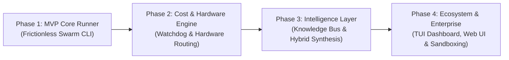

# HiveMind Development Roadmap

This document outlines the phased engineering milestones for building **HiveMind**, from the initial MVP to advanced hybrid synthesis and real-time knowledge sharing.

---

## 🗺️ Milestone Summary

| Phase | Focus Areas | Targeted Gaps | Primary Outcome |
| :--- | :--- | :--- | :--- |
| **Phase 1: MVP (`hive` CLI)** | Functional `hive` CLI tool (Check, Dispatch, Results table, Merge), Git Branching, SSH/Tailscale execution | **Gap 4** (Ad-Hoc Swarm CLI) | Fully functional `hive` CLI to run multi-machine parallel coding jobs. |
| **Phase 2: Optimization** | Early Stopping Watchdog, Hardware-Aware Routing | **Gap 3** (Token Costs) & **Gap 5** (Hardware Routing) | 50%+ token cost reduction & optimal hardware usage. |
| **Phase 3: Intelligence** | Shared Knowledge Bus, Hybrid Solution Splicing | **Gap 1** (Siloed Agents) & **Gap 2** (Winner-Take-All Waste) | Cross-worker learning and multi-branch code synthesis. |
| **Phase 4: Polish** | Interactive TUI Dashboard, Web UI, MicroVM Sandboxing (gVisor/E2B) | Security & Developer Experience | Advanced visual UI polish and production sandboxing. |

---

## Phase 1: MVP Core Runner & `hive` CLI (The Foundation)
**Goal:** Build the complete functional `hive` CLI tool (package `hivemind`) on the Master machine to dispatch coding tasks across 2–5 machines, execute them using headless coding agents (Claude Code / `agy`), and report back git branches and benchmark metrics.

### Key Deliverables:
- [ ] **Core `hive` CLI Application (`hivemind` package)**:
  - Built with Python (`typer`/`click` + `rich` console output).
  - Commands: `hive check`, `hive dispatch`, `hive status`, `hive merge`.
- [ ] **Cluster Configuration Engine (`hive check`)**: Parse `cluster.json` and validate machine connectivity over Tailscale/SSH.
- [ ] **Remote Git Branching Harness**: Script remote workers to pull the latest `main`, check out isolated experimental branches (`exp/<worker-id>-<strategy>`), and manage workspace states.
- [ ] **Headless Agent Invocation**: Implement remote wrappers to trigger headless CLI sessions (`claude -p "..."` / `agy exec "..."` / `aider --message "..."`).
- [ ] **Result Aggregation**: Collect stdout/stderr, test pass/fail exit codes, and benchmark JSON outputs back to the Master node.
- [ ] **Interactive Merge Assistant (`hive merge`)**: Master CLI displays a clean summary table and prompts the user to inspect diffs and merge the winning branch into `main`.

---

## Phase 2: Cost & Hardware Efficiency (Pragmatic Optimization)
**Goal:** Prevent runaway API token costs and optimize workload distribution across heterogeneous hardware (GPUs vs. High-Core CPUs).

### Key Deliverables:
- [ ] **Progress-Aware Watchdog Engine**:
  - Track live test pass rates, compiler tracebacks, and turn counts across all worker nodes.
  - Implement **ASHA-style early pruning**: automatically abort worker runs that show no progress or looping errors after $N$ turns.
- [ ] **Hardware-Aware Task Matcher**:
  - Allow workers to declare capabilities in `cluster.json` (e.g., `["gpu", "cuda12"]`, `["high-cpu", "64-cores"]`, `["browser-tools"]`).
  - Master's planning prompt automatically assigns compute-heavy/GPU tasks to capable nodes and lightweight refactoring to standard nodes.
- [ ] **Budget & Token Telemetry**: Real-time tracking of token spend and execution duration per machine.

---

## Phase 3: The Intelligence Layer (The Differentiator)
**Goal:** Transform the system from an isolated batch runner into a collaborative swarm where agents share discoveries and combine partial solutions.

### Key Deliverables:
- [ ] **Live Real-Time Knowledge Bus**:
  - Implement a lightweight pub/sub stream (via Redis or Tailscale HTTP/SSE) for discoveries.
  - Background parser extracts critical findings (e.g., undocumented bugs, dependency constraints, schema requirements) from worker logs.
  - Dynamically injects new discoveries into active worker scratchpads / system prompts mid-run.
- [ ] **Multi-Branch Hybrid Synthesizer (AST Splicing)**:
  - When no single branch gets a 100% score, or when multiple branches solve different sub-problems (e.g., Branch A: Fast Algorithm, Branch B: Comprehensive Tests, Branch C: Clean API):
  - Master LLM reads the diffs of all surviving branches.
  - Master synthesizes a unified, non-conflicting Pull Request combining the best components.
  - Automatically runs the unified test suite to verify the hybrid solution.

---

## Phase 4: Production Polish, UI & Sandboxing
**Goal:** Enhance security, observability, and user interface for production use.

### Key Deliverables:
- [ ] **Interactive TUI Dashboard**: Terminal User Interface (built with `textual` or `rich`) displaying real-time streaming agent thoughts, test counters, and hardware utilization per node.
- [ ] **Container / MicroVM Sandboxing**:
  - Add optional Docker with **gVisor (`runsc`)** or **Daytona / E2B** microVM support on worker nodes to isolate untrusted code execution.
- [ ] **IDE & Plugin Integration**:
  - Custom slash commands for Antigravity (`/swarm`) and VS Code / Cursor extensions.
- [ ] **Self-Hosting Web Dashboard (Optional)**: Web-based overview of historical swarm runs, benchmark curves, and token cost analytics.
