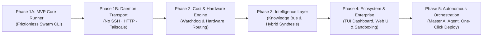

# HiveMind Development Roadmap

This document outlines the phased engineering milestones for building **HiveMind**, from the initial MVP to advanced hybrid synthesis and real-time knowledge sharing.

---

## 🗺️ Milestone Summary



| Phase                             | Focus Areas                                                                                                | Targeted Gaps                                                 | Primary Status                                                         |
| --------------------------------- | ---------------------------------------------------------------------------------------------------------- | ------------------------------------------------------------- | ---------------------------------------------------------------------- |
| **Phase 1A: MVP (`hive` CLI)**    | Functional `hive` CLI tool (Check, Dispatch, Results table, Merge), Git Branching, initial runner          | **Gap 4** (Ad-Hoc Swarm CLI)                                  | **Completed & Validated** ✅                                           |
| **Phase 1B: Daemon Transport**    | Replace SSH with `hivemind-worker` HTTP daemon on port 7422, Tailscale fleet discovery, fleet API key auth | **Security** (No raw shell access) & **Cross-OS** (Windows/Linux) | **Completed & Validated** ✅                                           |
| **Phase 2: Optimization**         | Early Stopping Watchdog, Hardware-Aware Routing                                                            | **Gap 3** (Token Costs) & **Gap 5** (Hardware Routing)        | Planned                                                                |
| **Phase 3: Intelligence**         | Shared Knowledge Bus, Hybrid Solution Splicing                                                             | **Gap 1** (Siloed Agents) & **Gap 2** (Winner-Take-All Waste) | Planned                                                                |
| **Phase 4: Polish**               | Interactive TUI Dashboard, Web UI, MicroVM Sandboxing (gVisor/Docker)                                      | Security & Developer Experience                               | Planned (TUI in progress)                                              |
| **Phase 5: Autonomous Agent**     | Master AI Agent (claude/agy) with hive MCP tools, autonomous dispatch/merge, human-in-the-loop only at `git push` | Full autonomy, minimal human intervention                     | Planned                                                                |

---

## Phase 1A: MVP Core Runner & `hive` CLI (The Foundation)

**Goal:** Build the complete functional `hive` CLI tool (package `hivemind`) on the Master machine to dispatch coding tasks across 2–5 machines, execute them using headless coding agents (Claude Code / `agy` / `aider`), and report back git branches and benchmark metrics.

### Key Deliverables:

- [x] **Core `hive` CLI Application (`hivemind` package)**:
  - Built with Python (`click` + `rich` console output).
  - Commands: `hive check`, `hive dispatch`, `hive status`, `hive merge`, `hive discover`, `hive list`, `hive keygen`.
- [x] **Cluster Configuration Engine (`hive check` & `hive discover`)**:
  - Global `~/.hivemind/cluster.json` and `~/.hivemind/fleet.key`.
  - Automatic hardware probing (`SystemProber`) for CPU cores, RAM, OS, architecture, and agent CLIs.
- [x] **Tailscale Fleet Discovery (`hive discover --tailscale`)**:
  - `TailscaleScanner` queries `tailscale status --json` for instant (<0.1s) peer lookup with OS type and Tailscale IPs.
  - Discovery mode flags: `--tailscale` / `--local` / interactive subnet scan.
- [x] **Remote Git Branching Harness**: Workers pull the latest base branch, checkout isolated experimental branches (`exp/<worker-id>-<strategy>`), and manage workspace states.
- [x] **Headless Agent Invocation**: Trigger headless CLI sessions (`claude -p "..."` / `agy -p "..."` / `aider --message "..."`).
- [x] **Result Aggregation**: Collect stdout/stderr, test pass/fail exit codes, and benchmark JSON outputs back to Master node.
- [x] **Interactive Merge Assistant (`hive merge`)**: Master CLI displays a clean summary table and prompts the user to inspect diffs and merge the winning branch into local base branch.

---

## Phase 1B: Daemon Transport Layer (No SSH · Secure · Cross-Platform)

**Goal:** Replace the raw SSH shell execution model with a lightweight, purpose-built `hivemind-worker` HTTP daemon running on port `7422` on each worker machine. The master communicates exclusively via HTTP REST calls authenticated with a shared fleet API key — no SSH keys, no shell access, no exposed user accounts.

> **Validation Status ✅ (Live Cluster Validated):**
> - **Master:** Windows (`Artemis`) running `hive` CLI (`hivemind` package).
> - **Worker:** Linux (`ari` at `100.101.58.76:7422`) running `hivemind-worker` systemd service.
> - **Authentication:** Fleet API Key bearer authentication verified across `/health`, `/dispatch`, `/status`.
> - **Execution:** Task dispatched via HTTP POST → `aider` agent resolved bug in `add.py` → `python3 check.py` passed → git branch `exp/ari-strategy-1` committed and pushed via SSH to GitHub origin → `hive status` verified.

### Architecture:

```
Master (Artemis)                          Worker Daemon (ari / Hermes / any)
       │                                         │
       │── POST /dispatch ─────────────────────►│  Receives: prompt, repo, test cmd, model
       │                                         │
       │                                         │──► git clone/fetch shared repo
       │                                         │──► run aider / agy / claude on workspace
       │                                         │──► git add -A → commit → push exp/* branch
       │                                         │──► write final status to internal state
       │                                         │
       │── GET  /status/<run-id> ───────────────►│  Returns: {status, branch, logs, test_exit}
       │── GET  /health ─────────────────────────►│  Returns: {os, arch, cpu, ram, engines, version}
       │── DEL  /cancel/<run-id> ───────────────►│  Kills running agent subprocess
       │                                         │
```

### Key Deliverables:

- [x] **`hivemind-worker` Daemon Package** (standalone Python package):
  - FastAPI + uvicorn server, cross-platform (Linux & Windows).
  - Endpoints: `POST /dispatch`, `GET /status/<run-id>`, `GET /health`, `DELETE /cancel/<run-id>`.
  - Runs AI agents (`aider`, `agy`, `claude-code`) as managed subprocesses with isolated workspaces.
  - Automatically handles git clone, branch checkout, test execution, commit, and git push.
  - Environment stripping & security: Only passes essential system variables and AI provider keys.
- [x] **`hive keygen`** — generates and saves shared fleet API key (`~/.hivemind/fleet.key`).
- [x] **Updated `remote.py`** — pure HTTP REST `POST /dispatch` dispatching via `httpx`.
- [x] **Updated `status.py`** — pure HTTP REST `GET /status/<run-id>` polling with graceful offline handling.
- [x] **Updated `discover/check`** — pure HTTP REST `GET /health` probing with live hardware and tool capability detection.
- [x] **Updated `cluster.json` schema** — default port 7422, fleet key authorization support.
- [x] **Daemon Background Services**: Documented systemd service for Linux and background / Task Scheduler / NSSM for Windows.

---

## Phase 2: Cost & Hardware Efficiency (Pragmatic Optimization)

**Goal:** Prevent runaway API token costs and optimize workload distribution across heterogeneous hardware (GPUs vs. High-Core CPUs).

### Key Deliverables:

- [ ] **Progress-Aware Watchdog Engine**:
  - Track live test pass rates, compiler tracebacks, and turn counts across all worker nodes.
  - Implement **ASHA-style early pruning**: automatically abort worker runs that show no progress or looping errors after $N$ turns.
- [ ] **Hardware-Aware Task Matcher**:
  - Allow workers to declare capabilities in `cluster.json` (e.g., `["gpu", "cuda12"]`, `["high-cpu", "64-cores"]`, `["browser-tools"]`).
  - Master's planning prompt automatically assigns compute-heavy/GPU tasks to capable nodes and lightweight refactoring to standard nodes.
- [ ] **Budget & Token Telemetry**: Real-time tracking of token spend and execution duration per machine.

---

## Phase 3: The Intelligence Layer (The Differentiator)

**Goal:** Transform the system from an isolated batch runner into a collaborative swarm where agents share discoveries and combine partial solutions.

### Key Deliverables:

- [ ] **Live Real-Time Knowledge Bus**:
  - Implement a lightweight pub/sub stream (via Redis or Tailscale HTTP/SSE) for discoveries.
  - Background parser extracts critical findings (e.g., undocumented bugs, dependency constraints, schema requirements) from worker logs.
  - Dynamically injects new discoveries into active worker scratchpads / system prompts mid-run.
- [ ] **Multi-Branch Hybrid Synthesizer (AST Splicing)**:
  - When no single branch gets a 100% score, or when multiple branches solve different sub-problems (e.g., Branch A: Fast Algorithm, Branch B: Comprehensive Tests, Branch C: Clean API):
  - Master LLM reads the diffs of all surviving branches.
  - Master synthesizes a unified, non-conflicting Pull Request combining the best components.
  - Automatically runs the unified test suite to verify the hybrid solution.

---

## Phase 4: Production Polish, UI & Sandboxing

**Goal:** Enhance security, observability, and user interface for production use.

### Key Deliverables:

- [ ] **Interactive TUI Dashboard**: Terminal User Interface (built with `textual` or `rich`) displaying real-time streaming agent thoughts, test counters, and hardware utilization per node.
- [ ] **Container / MicroVM Sandboxing** (`--sandbox` flag, opt-in):
  - Daemon gains a `--sandbox docker` startup flag. When active, each agent subprocess runs inside a Docker container with only the workspace volume mounted.
  - Advanced option: **gVisor (`runsc`)** runtime on Linux for syscall-level isolation.
- [ ] **IDE & Plugin Integration**:
  - Custom slash commands for Antigravity (`/swarm`) and VS Code / Cursor extensions.
- [ ] **Self-Hosting Web Dashboard (Optional)**: Web-based overview of historical swarm runs, benchmark curves, and token cost analytics.

---

## Phase 5: Autonomous Orchestration (The End Goal)

**Goal:** Wire a master AI agent (Claude Code, `agy`, or any MCP-capable agent) directly to the `hive` CLI so it can autonomously decide when to use distributed computing, dispatch the swarm, evaluate results, and merge the winner — with the human only reviewing the final diff and running `git push`.

### How the Layers Stack Up

```
Layer 5 ─ YOU
         │  Give a high-level task in natural language.
         │  Review the final diff. Run git push.
         ▽
Layer 4 ─ MASTER AI AGENT  (claude code / agy on your machine)
         │  Decides: solve locally OR dispatch to hive?
         │  Decomposes task into named strategies.
         │  Calls hive MCP tools: dispatch → poll status → auto-merge winner.
         │  Reads test results, picks winner by score, writes PR description.
         ▽
Layer 3 ─ HIVE CLI  (Phase 1–3 deliverables)
         │  hive dispatch / status / merge
         │  HTTP daemon orchestration, git branching harness, result aggregation.
         ▽
Layer 2 ─ WORKER AGENTS  (aider / claude / agy on each machine)
         │  Headless coding sessions on isolated exp/* branches.
         │  Each agent pursues a different strategy independently.
         ▽
Layer 1 ─ GIT ORIGIN  (GitHub / GitLab / self-hosted)
           Shared truth. All branches converge here.
           Master fetches the winner; human pushes main.
```

### Key Deliverables:

- [ ] **`hive` MCP Server** (`src/hivemind/mcp/`):
  - Expose three MCP tools callable by any MCP-compatible agent:
    - `hive_dispatch(prompt, strategies, repo, test_cmd, workers)` — starts a swarm run, returns `run_id`.
    - `hive_status(run_id?)` — returns structured JSON.
    - `hive_merge(worker_id, run_id?)` — fetches and merges the winning branch; returns the merged diff.
- [ ] **Master Agent System Prompt / Rules**: Reusable rule file for autonomous swarm decisions.
- [ ] **Autonomous Dispatch — Poll — Merge Loop**: Autonomous agent pipeline that only requires human interaction at the final push.
- [ ] **Task Decomposition Prompt**: Autonomous generation of diverse implementation strategies.
- [ ] **Merge Conflict Guard**: Pre-check and automated conflict mitigation before presenting diffs.
- [ ] **One-Click / Slash Command UX**: `/swarm "<task>"` for frictionless execution.

---

### Implementation Order

1. **Phase 1A done** → `hive dispatch / status / merge` CLI foundation ✅
2. **Phase 1B done** → HTTP Daemon transport layer on port 7422, fleet key auth, Tailscale discovery, verified on live fleet ✅
3. **Phase 2** → Watchdog prevents runaway costs before giving agents autonomy
4. **Phase 3** → Knowledge Bus + hybrid synthesizer maximizes output quality
5. **Phase 4** → Production polish, TUI dashboard, container sandboxing
6. **Phase 5** → MCP server, autonomous master agent, slash command integration
