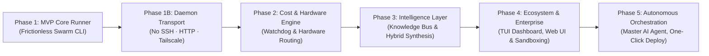

# HiveMind Development Roadmap

This document outlines the phased engineering milestones for building **HiveMind**, from the initial MVP to advanced hybrid synthesis and real-time knowledge sharing.

---

## 🗺️ Milestone Summary




| Phase                             | Focus Areas                                                                                                | Targeted Gaps                                                 | Primary Outcome                                                        |
| --------------------------------- | ---------------------------------------------------------------------------------------------------------- | ------------------------------------------------------------- | ---------------------------------------------------------------------- |
| **Phase 1A: MVP (`hive` CLI)**    | Functional `hive` CLI tool (Check, Dispatch, Results table, Merge), Git Branching, SSH-based execution     | **Gap 4** (Ad-Hoc Swarm CLI)                                  | Fully functional `hive` CLI to run multi-machine parallel coding jobs. |
| **Phase 1B: Daemon Transport**    | Replace SSH with `hivemind-worker` HTTP daemon on port 7422, Tailscale fleet discovery, fleet API key auth | **Security** (No raw shell access) & **Cross-OS** (Windows workers) | Zero-SSH execution — master talks to daemon, daemon runs agent locally. |
| **Phase 2: Optimization**         | Early Stopping Watchdog, Hardware-Aware Routing                                                            | **Gap 3** (Token Costs) & **Gap 5** (Hardware Routing)        | 50%+ token cost reduction & optimal hardware usage.                    |
| **Phase 3: Intelligence**         | Shared Knowledge Bus, Hybrid Solution Splicing                                                             | **Gap 1** (Siloed Agents) & **Gap 2** (Winner-Take-All Waste) | Cross-worker learning and multi-branch code synthesis.                 |
| **Phase 4: Polish**               | Interactive TUI Dashboard, Web UI, MicroVM Sandboxing (gVisor/E2B)                                         | Security & Developer Experience                               | Advanced visual UI polish and production sandboxing.                   |
| **Phase 5: Autonomous Agent**     | Master AI Agent (claude/agy) with hive MCP tools, autonomous dispatch/merge, human-in-the-loop only at `git push` | Full autonomy, minimal human intervention                     | Give a task, get a PR. Human only reviews and pushes.                  |


---


## Phase 1A: MVP Core Runner & `hive` CLI (The Foundation)

**Goal:** Build the complete functional `hive` CLI tool (package `hivemind`) on the Master machine to dispatch coding tasks across 2–5 machines, execute them using headless coding agents (Claude Code / `agy` / `aider`), and report back git branches and benchmark metrics.

### Key Deliverables:

- [x] **Core** `hive` **CLI Application (**`hivemind` **package)**:
  - Built with Python (`click` + `rich` console output).
  - Commands: `hive check`, `hive dispatch`, `hive status`, `hive merge`, `hive discover`, `hive list`.
- [x] **Cluster Configuration Engine (**`hive check` **&** `hive discover`**)**:
  - Parse global `~/.hivemind/cluster.json` and validate machine connectivity over standard SSH.
  - Automatic hardware probing (`SystemProber`) for CPU cores, RAM, GPU, Docker, and agent CLIs.
- [x] **Two-Stage Connectivity & Validation Plan**:
  - **Stage 1A ✅ VALIDATED (Local Network / SSH)**: Full dispatch → status → merge cycle confirmed on a real 2-machine LAN cluster.
    - **Master:** Windows machine (`Artemis`) running `hive` CLI.
    - **Worker (`ari`):** Ubuntu machine, passwordless SSH, same LAN (`192.168.1.69`).
    - **Agent tested:** `aider` with model `openrouter/openrouter/free` — requires `OPENROUTER_API_KEY` exported on the worker.
    - **Test fixture:** `add.py` bug → aider patched it → `python3 check.py` passed → branch pushed to GitHub origin → `hive merge` into local `main`.
  - **Stage 1B → Superseded by Phase 1B:** Remote Tailscale testing will be done using the new daemon transport instead of raw SSH.
- [x] **Tailscale Fleet Discovery (`hive discover --tailscale`):**
  - `TailscaleScanner` queries `tailscale status --json` for instant (<0.1s) peer lookup with OS type and Tailscale IPs.
  - Discovery mode flags: `--tailscale` / `--local` / interactive menu (auto-detects Tailscale presence).
  - Probing skips SSH-closed Windows machines and shows a clear actionable error on auth failure.
- [ ] **Local Directory Configuration (**`hive init`**)**:
  - Support project-level configuration overrides (`./cluster.json` or `.hive/config.json`) alongside the global `~/.hivemind/cluster.json`.
  - Enable per-repository worker selection, custom workspace folder mappings, and project-specific build/test commands.
- [x] **Remote Git Branching Harness**: Script remote workers to pull the latest `main`, check out isolated experimental branches (`exp/<worker-id>-<strategy>`), and manage workspace states.
- [x] **Headless Agent Invocation**: Implement remote wrappers to trigger headless CLI sessions (`claude -p "..."` / `agy -p "..."` / `aider --message "..."`).
- [x] **Result Aggregation**: Collect stdout/stderr, test pass/fail exit codes, and benchmark JSON outputs back to the Master node.
- [x] **Interactive Merge Assistant (**`hive merge`**)**: Master CLI displays a clean summary table and prompts the user to inspect diffs and merge the winning branch into `main`.

---


## Phase 1B: Daemon Transport Layer (No SSH · Secure · Cross-Platform)

**Goal:** Replace the raw SSH shell execution model with a lightweight, purpose-built `hivemind-worker` HTTP daemon running on port `7422` on each worker machine. The master communicates exclusively via HTTP REST calls authenticated with a shared fleet API key — no SSH keys, no shell access, no exposed user accounts.

> **Why:** SSH grants the master a raw shell on the worker's personal user account. On machines owned by different people (e.g. a friend's Windows machine), this is a security risk — the master could read personal files, browser data, credentials, etc. The daemon exposes exactly 4 typed endpoints and nothing else.

### Architecture:

```
Master (Artemis)                          Worker Daemon (ari / Hermes / any)
       │                                         │
       │── POST /dispatch ─────────────────────►│  Receives: prompt, repo, test cmd, model
       │                                         │
       │                                         │──► git clone/fetch shared repo
       │                                         │──► run aider / agy / claude on workspace
       │                                         │──► git add -A → commit → push exp/* branch
       │                                         │──► write final status to internal state
       │                                         │
       │── GET  /status/<run-id> ───────────────►│  Returns: {status, branch, logs, test_exit}
       │── GET  /health ─────────────────────────►│  Returns: {os, arch, cpu, ram, engines, version}
       │── DEL  /cancel/<run-id> ───────────────►│  Kills running agent subprocess
       │                                         │
```

### How Probing Works (Replacing SSH Probe):

`hive discover` no longer runs a Python script over SSH. Instead:
1. Get list of IPs (from Tailscale or local subnet scan).
2. For each IP, try `GET http://<ip>:7422/health` with the fleet API key (timeout: 1.5s).
3. Daemon responds with full hardware + tool profile as JSON in `<0.1s`.
4. No response → daemon not installed → shown as `HiveMind not installed`.

```
Discovered Peers (Tailscale Mesh)
──────────────────────────────────────────────────────────────────
#   IP               Hostname   HiveMind Daemon    OS / Capabilities
──────────────────────────────────────────────────────────────────
1   100.101.58.76    ari        ✓ Ready (idle)     linux · aider · agy
2   100.115.119.6    Hermes     ✗ Not installed    windows (install daemon first)
3   100.77.177.65    Artemis    — (this machine)
──────────────────────────────────────────────────────────────────
```

### Security Model:

| Mechanism | Detail |
|---|---|
| **Tailscale Network** | Daemon only listens on `100.x.x.x` virtual IP — invisible to public internet |
| **Fleet API Key** | Single shared key for the whole fleet, stored in `~/.hivemind/fleet.key`. Every request requires `Authorization: Bearer <key>` |
| **Workspace Isolation** | Daemon only reads/writes one designated folder (`~/hive-workspace` or `C:\hive-workspace`) |
| **No Shell Exposure** | 4 typed endpoints only. Master cannot run arbitrary commands or read arbitrary files |
| **Works on both local & Tailscale** | Daemon listens on all interfaces — master uses local IP (`192.168.x.x`) or Tailscale IP (`100.x.x.x`) transparently |
| **Stripped Subprocess Environment** | Agent subprocess is launched with a **minimal, explicit env** — only `PATH`, `HOME` (pointed at workspace dir), git vars, and the required API key(s). Personal SSH keys, browser credentials, and all other env vars are excluded. Not a true sandbox, but meaningfully limits credential leakage and `~` expansion. |

> **Note on full sandboxing:** True process sandboxing (Docker, gVisor) is deferred to Phase 4 as an opt-in `--sandbox docker` flag on the daemon. The stripped-env approach is the Phase 1B baseline — safe enough for a trusted fleet, not yet suitable for untrusted third-party workers.

### Worker Installation (Manual, One-Time, No SSH Required):

```bash
# Worker machine (Linux - ari)
pip install hivemind-worker
hivemind-worker start --key <fleet-api-key> --port 7422

# Worker machine (Windows - Hermes)
pip install hivemind-worker
hivemind-worker start --key <fleet-api-key> --port 7422
```

Fleet API key is generated once on the master:
```powershell
hive keygen
# → hive-fleet-key-a1b2c3d4e5f6...
# → Saved to ~/.hivemind/fleet.key
```

### Key Deliverables:

- [ ] **`hivemind-worker` Daemon Package** (new standalone Python package):
  - FastAPI + uvicorn server, cross-platform (Linux & Windows).
  - 4 endpoints: `POST /dispatch`, `GET /status/<run-id>`, `GET /health`, `DELETE /cancel/<run-id>`.
  - Runs the AI agent as a local subprocess (identical to `worker.sh` today, but inside Python).
  - Manages workspace isolation — all git operations confined to `~/hive-workspace`.
- [ ] **`hive keygen`** — generates and saves the shared fleet API key.
- [ ] **Updated `remote.py`** — replace SSH upload + nohup with `POST /dispatch` HTTP call.
- [ ] **Updated `status.py`** — replace SSH `result.json` read with `GET /status/<run-id>` HTTP call.
- [ ] **Updated `discover/check`** — replace SSH connectivity check with `GET /health` probe.
- [ ] **Updated `cluster.json` schema** — add `fleet_key` field; remove SSH-specific fields where applicable.
- [ ] **`hive tui`** daemon mode — show daemon health per worker in the TUI dashboard.

---


## Phase 2: Cost & Hardware Efficiency (Pragmatic Optimization)

**Goal:** Prevent runaway API token costs and optimize workload distribution across heterogeneous hardware (GPUs vs. High-Core CPUs).

### Key Deliverables:

- [ ] **Progress-Aware Watchdog Engine**:
  - Track live test pass rates, compiler tracebacks, and turn counts across all worker nodes.
  - Implement **ASHA-style early pruning**: automatically abort worker runs that show no progress or looping errors after $N$ turns.
- [ ] **Hardware-Aware Task Matcher**:
  - Allow workers to declare capabilities in `cluster.json` (e.g., `["gpu", "cuda12"]`, `["high-cpu", "64-cores"]`, `["browser-tools"]`).
  - Master's planning prompt automatically assigns compute-heavy/GPU tasks to capable nodes and lightweight refactoring to standard nodes.
- [ ] **Budget & Token Telemetry**: Real-time tracking of token spend and execution duration per machine.

---


## Phase 3: The Intelligence Layer (The Differentiator)

**Goal:** Transform the system from an isolated batch runner into a collaborative swarm where agents share discoveries and combine partial solutions.

### Key Deliverables:

- [ ] **Live Real-Time Knowledge Bus**:
  - Implement a lightweight pub/sub stream (via Redis or Tailscale HTTP/SSE) for discoveries.
  - Background parser extracts critical findings (e.g., undocumented bugs, dependency constraints, schema requirements) from worker logs.
  - Dynamically injects new discoveries into active worker scratchpads / system prompts mid-run.
- [ ] **Multi-Branch Hybrid Synthesizer (AST Splicing)**:
  - When no single branch gets a 100% score, or when multiple branches solve different sub-problems (e.g., Branch A: Fast Algorithm, Branch B: Comprehensive Tests, Branch C: Clean API):
  - Master LLM reads the diffs of all surviving branches.
  - Master synthesizes a unified, non-conflicting Pull Request combining the best components.
  - Automatically runs the unified test suite to verify the hybrid solution.

---


## Phase 4: Production Polish, UI & Sandboxing

**Goal:** Enhance security, observability, and user interface for production use.

### Key Deliverables:

- [ ] **Interactive TUI Dashboard**: Terminal User Interface (built with `textual` or `rich`) displaying real-time streaming agent thoughts, test counters, and hardware utilization per node. _(Prototype exists on `feature/tui` branch — being developed in parallel.)_
- [ ] **Container / MicroVM Sandboxing** (`--sandbox` flag, opt-in):
  - Daemon gains a `--sandbox docker` startup flag. When active, each agent subprocess runs inside a Docker container with only the workspace volume mounted — no host filesystem access.
  - Advanced option: **gVisor (**`runsc`**)** runtime on Linux for syscall-level isolation (suitable for untrusted third-party workers).
  - The daemon's subprocess launcher already uses a stripped env (Phase 1B baseline); this upgrades isolation from env-stripping to full container confinement.
  - **Not required for a trusted personal fleet** — only needed when onboarding unknown workers.
- [ ] **IDE & Plugin Integration**:
  - Custom slash commands for Antigravity (`/swarm`) and VS Code / Cursor extensions.
- [ ] **Self-Hosting Web Dashboard (Optional)**: Web-based overview of historical swarm runs, benchmark curves, and token cost analytics.

---


## Phase 5: Autonomous Orchestration (The End Goal)

**Goal:** Wire a master AI agent (Claude Code, `agy`, or any MCP-capable agent) directly to the `hive` CLI so it can autonomously decide when to use distributed computing, dispatch the swarm, evaluate results, and merge the winner — with the human only reviewing the final diff and running `git push`.

> **The target experience:**
> You type: *"Optimize the query engine to handle >100k req/s."*
> The master agent figures out the rest. You get a PR.

---

### How the Layers Stack Up

```
Layer 5 ─ YOU
         │  Give a high-level task in natural language.
         │  Review the final diff. Run git push.
         ▽
Layer 4 ─ MASTER AI AGENT  (claude code / agy on your machine)
         │  Decides: solve locally OR dispatch to hive?
         │  Decomposes task into named strategies.
         │  Calls hive MCP tools: dispatch → poll status → auto-merge winner.
         │  Reads test results, picks winner by score, writes PR description.
         ▽
Layer 3 ─ HIVE CLI  (Phase 1–3 deliverables)
         │  hive dispatch / status / merge
         │  HTTP daemon orchestration, git branching harness, result aggregation.
         ▽
Layer 2 ─ WORKER AGENTS  (aider / claude / agy on each machine)
         │  Headless coding sessions on isolated exp/* branches.
         │  Each agent pursues a different strategy independently.
         ▽
Layer 1 ─ GIT ORIGIN  (GitHub / GitLab / self-hosted)
           Shared truth. All branches converge here.
           Master fetches the winner; human pushes main.
```

---

### Key Deliverables:

- [ ] **`hive` MCP Server** (`src/hivemind/mcp/`):
  - Expose three MCP tools callable by any MCP-compatible agent (claude code, agy, etc.):
    - `hive_dispatch(prompt, strategies, repo, test_cmd, workers)` — starts a swarm run, returns `run_id`.
    - `hive_status(run_id?)` — returns structured JSON (per-worker status, test exit codes, branches).
    - `hive_merge(worker_id, run_id?)` — fetches and merges the winning branch; returns the merged diff.
  - Built with the [MCP Python SDK](https://github.com/modelcontextprotocol/python-sdk). Registered in `~/.gemini/config` (for `agy`) or `claude_desktop_config.json` (for Claude).

- [ ] **Master Agent System Prompt / Rules**:
  - A reusable rule file (`.rules/hive-orchestrator.md` or agy rule) that tells the master agent:
    - **When to dispatch:** Task has competing design trade-offs, is perf-critical, or is estimated >30 min for a single agent.
    - **When to solve locally:** Fix is clearly specified, single obvious implementation, or cluster is empty.
    - **How to pick a winner:** Prefer `test_exit_code == 0` first; break ties with benchmark score; fall back to first-to-finish.
    - **What to leave to the human:** Only `git push` and the final review. Everything else is autonomous.

- [ ] **Autonomous Dispatch — Poll — Merge Loop**:
  - Master agent calls `hive_dispatch` and then polls `hive_status` every 30s (no human involvement).
  - When all workers finish, it calls `hive_merge` on the highest-scoring branch automatically.
  - Generates a structured summary: what each strategy tried, diff stats, test results, recommendation.
  - Presents the summary + diff to the human for a one-look review before `git push`.

- [ ] **Task Decomposition Prompt** (master agent pre-step):
  - Before dispatching, the master agent reads the codebase (or a project summary) and writes N strategy descriptions, one per available worker.
  - Example for *"optimize the query engine"*:
    - Strategy 1: `"Use SIMD intrinsics for the hot loop in query.c"`
    - Strategy 2: `"Replace the global lock with per-shard actor queues"`
    - Strategy 3: `"Memory-map the index file to eliminate syscall overhead"`
  - These become the `--strategy` arguments, and each worker's prompt gets the strategy appended automatically.

- [ ] **Merge Conflict Guard**:
  - Before presenting the diff to the human, the agent checks for merge conflicts with `git merge --no-commit --no-ff`.
  - If conflicts exist, it attempts an LLM-assisted resolution (Phase 3 hybrid synthesizer) or flags for human resolution.
  - Only conflict-free merges are auto-completed; the human is notified of anything that needs manual intervention.

- [ ] **One-Click / Slash Command UX**:
  - Register `/swarm "<task>"` as an `agy` slash command that triggers the full autonomous loop.
  - The command blocks in the terminal showing a live status table until all workers finish, then drops the human into the merge review.

---

### Human Intervention Points (intentionally minimal)

| Step | Who does it | Notes |
|------|-------------|-------|
| Give the task | **Human** | Natural language, no flags needed |
| Decide to dispatch or solve locally | **Master agent** | Autonomous |
| Decompose into strategies | **Master agent** | Autonomous |
| HTTP dispatch to daemon workers | **`hive` CLI** | Autonomous |
| Code the fix | **Worker agents** | Autonomous |
| Test, commit, push branch | **`hivemind-worker` daemon** | Autonomous |
| Pick winner, merge into local main | **Master agent** | Autonomous |
| Review diff, run `git push` | **Human** | ← only remaining step |

---

### Implementation Order

This phase builds directly on Phases 1–3. Recommended sequence:

1. **Phase 1A done** → `hive dispatch / status / merge` works over SSH (current state ✅)
2. **Phase 1B** → Replace SSH with daemon transport — validates Tailscale fleet (ari + Hermes)
3. **Phase 2** → Watchdog prevents runaway costs before giving agents autonomy
4. **Phase 3** → Knowledge Bus + hybrid synthesizer maximizes output quality
5. **Phase 5 — MCP server** (can be prototyped after Phase 1B, even before Phase 2/3)
6. **Phase 5 — System prompt + polling loop** (wire the agent to the tools)
7. **Phase 5 — Slash command** (`/swarm`) for one-line UX

> **Note:** The MCP server wrapper (step 5) is mostly plumbing and can be prototyped in parallel with Phase 2. The real intelligence — knowing *when* to dispatch and *how* to decompose — comes from the system prompt and improves as Phases 2–3 add more signal (watchdog data, benchmark scores, cross-worker discoveries).
